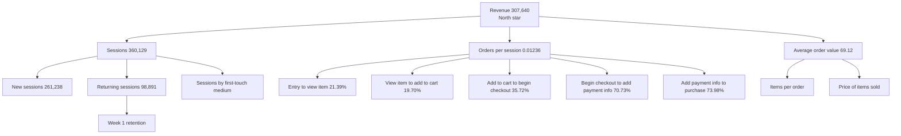

# KPI tree

North-star metric: **revenue**. It splits into traffic, how many sessions turn into orders, and how big each order is. Values are for 2020-11-01 to 2021-01-31, from `results/ba_kpi_tree_values.csv` (made by `python -m scripts.ba_numbers` from other files in `results/`). Owners are **proposed** roles (an assumption, to be agreed with the business).

## Diagram

Orders per session and the five step conversions are linked but not the same number. Orders per session counts distinct real transaction ids over all sessions. The product of the step conversions (0.79%) uses the strict funnel and counts sessions, not orders, so the two differ (see `docs/METRICS.md` and `docs/DATA_QUALITY.md`).

Check that the tree adds up: sessions x orders per session x average order value = 307,640 (`results/ba_kpi_tree_values.csv`, row "Revenue check").

## Metric definitions and owners

| Level | Metric | Definition | Current value | Source | Proposed owner |
|---|---|---|---|---|---|
| 1 | Revenue | Sum of purchase revenue, one event per real transaction id | 307,640 | `results/26_revenue_by_segment.csv` | Finance |
| 2 | Sessions | Distinct (user, session id) pairs | 360,129 | `results/20_funnel.csv` | Marketing |
| 2 | Orders per session | Distinct real transaction ids / sessions | 0.01236 | `results/ba_kpi_tree_values.csv` | E-commerce operations |
| 2 | Average order value | Revenue / orders | 69.12 | `results/26_revenue_by_segment.csv` | E-commerce operations |
| 3 | New sessions | Sessions with session number 1 | 261,238 | `results/22_segment_funnel.csv` | Marketing |
| 3 | Returning sessions | Sessions with session number above 1 | 98,891 | `results/22_segment_funnel.csv` | Marketing |
| 3 | Sessions by first-touch medium | Sessions grouped by the user's first source | see `results/22_segment_funnel.csv` | `results/22_segment_funnel.csv` | Marketing |
| 3 | Entry to view item | Sessions reaching view_item / sessions entering | 21.39% | `results/20_funnel.csv` | Product |
| 3 | View item to add to cart | Sessions reaching add_to_cart / sessions with view_item | 19.70% | `results/20_funnel.csv` | Product |
| 3 | Add to cart to begin checkout | Sessions reaching begin_checkout / sessions with add_to_cart | 35.72% | `results/20_funnel.csv` | Product |
| 3 | Begin checkout to add payment info | Sessions reaching add_payment_info / sessions with begin_checkout | 70.73% | `results/20_funnel.csv` | Product |
| 3 | Add payment info to purchase | Sessions reaching purchase / sessions with add_payment_info | 73.98% | `results/20_funnel.csv` | Product |
| 4 | Items per order | Units / orders | not yet measured at order level | none | E-commerce operations |
| 4 | Price of items sold | Item revenue / units | not yet measured | none | E-commerce operations |
| 4 | Week 1 retention | Users with a session one week after their first visit week / cohort size | 4.20% (full cohorts, weighted) | `results/dashboard_expected_values.csv` | Marketing |

All steps follow the order rule in `docs/METRICS.md`: a step counts only after the previous step in the same session.

## How the tree is used

- Each month, the revenue change is explained top down: did sessions, orders per session or average order value move, and then which step.
- A drop in one step conversion is a prompt for investigation, not proof of a cause (the data is observational).
- A step with fewer than 100 sessions in a segment is marked unreliable and not used for decisions.
