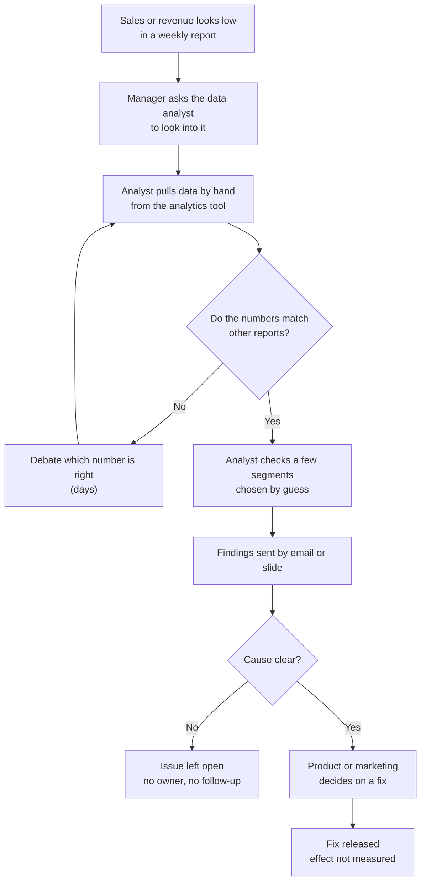
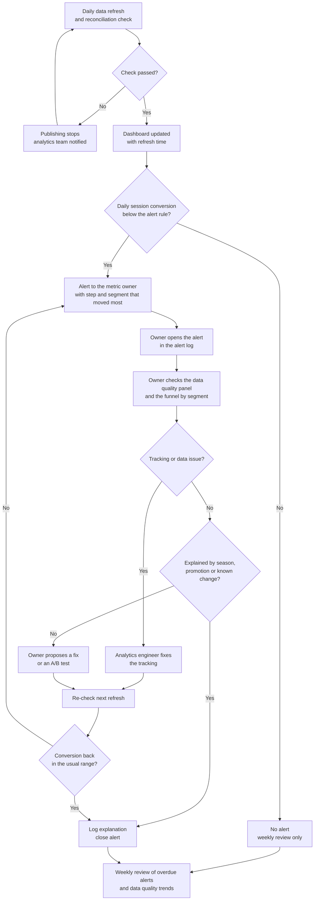

# Process flows: detecting and reacting to a conversion drop

Important: the **as-is** flow is an **assumed** picture of a typical store team without a funnel dashboard. It is not an observed process, because no process data was available. It must be validated with the team before it is used to justify change. The **to-be** flow is the process the Funnel Monitoring Dashboard in `BRD.md` supports. Role names match `KPI_TREE.md` and `BRD.md`.

Editable versions: `as_is.drawio` and `to_be.drawio` (open at https://app.diagrams.net or in draw.io Desktop).

## As-is (assumed)

Pain points (assumed): detection depends on a weekly report, so a drop can run for days; numbers differ between reports; segments are chosen by guess; there is no owner or log; the effect of a fix is not measured.

## To-be

What changes (design intent, not measured results): detection becomes daily, the alert names a step and a segment, there is one set of definitions, each alert has an owner and a status, and a fix is checked on the next refresh. Whether this shortens the time to detect is measured after go-live (`BRD.md`, section 10).

## Roles in the to-be flow

| Step | Role |
|---|---|
| Refresh and reconciliation | Analytics engineer, data analyst |
| Alert rule | Product manager and data analyst (RACI in `BRD.md`) |
| Respond to the alert | Metric owner (product, marketing or operations manager) |
| Tracking fixes | Analytics engineer |
| Weekly review | Head of e-commerce chairs, all owners attend |
